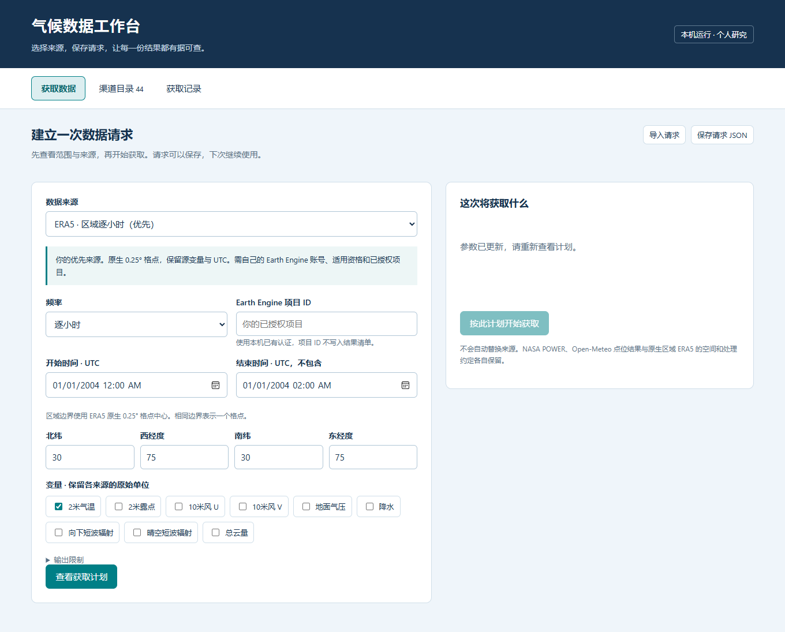

# 气候数据工作台 · climate-data-access

面向个人研究的本地气候数据工作台。**v0.2** 把中文页面、44 项渠道目录、可保存的请求、显式获取与结果核验放进同一个入口。目前可执行 **3 条路线**：区域 ERA5、NASA POWER 点位、Open-Meteo 固定 ERA5 点位；44 项目录不代表 44 个连接器。

[English](README.en.md) · [44 项获取指南](docs/public-access.md) · [验证状态](docs/status.md) · [架构](docs/architecture.md) · [扩展约定](docs/extending.md) · [成熟工具与复用方向](docs/ecosystem.md)

## 启动中文工作台

需要 Python 3.11 或更高版本。Windows 可双击仓库内的 **启动工作台.cmd**，首次按提示安装项目并启动；也可在仓库目录手动安装。

Windows PowerShell：

~~~powershell
python -m venv .venv
.\.venv\Scripts\Activate.ps1
python -m pip install -e .
climate-access serve --open
~~~

macOS / Linux：

~~~sh
python3 -m venv .venv
source .venv/bin/activate
python -m pip install -e .
climate-access serve --open
~~~

浏览器打开 http://127.0.0.1:8765。页面有“获取数据”“渠道目录”“获取记录”三个入口：选择来源与范围 → 查看获取计划 → 明确开始获取 → 查看结果并重新核验。可保存、导入请求 JSON，复用历史请求。默认优先选择 ERA5；首次试用无需账号路线时，可切换到 NASA POWER。

结果默认保存在本机 data/workbench，按 Ctrl+C 停止服务。自定义目录或端口：

~~~sh
climate-access serve --open --output data/workbench --port 8765
~~~

服务只监听本机地址。不会写入研究数据库、启用定时任务或上传私人研究文件。点位结果可在页面下载 CSV、原始 JSON 响应与来源清单；ERA5 保存压缩 NetCDF 批次，页面提供清单，数据文件从本地结果目录使用。

## 可执行路线

| 路线 | 获取范围 | 账号与输出 |
| --- | --- | --- |
| era5-gee（默认优先） | 区域逐小时，原生 0.25° 格点中心；9 个已支持变量，最多 744 小时 | 自己有资格使用的 GEE 项目和本机 SDK 认证；NetCDF + manifest |
| nasa-power | 单点逐日或逐小时；每次最多 31 天、8 个变量 | 公开 API，无需账号；CSV + raw.json + manifest |
| open-meteo | 单点逐小时，固定 models=era5；每次最多 31 天、8 个变量 | 公开非商业 API，无需账号；CSV + raw.json + manifest |

请求明确选择来源；失败不会换源。POWER 是来源派生的格点产品，不是气象站实测；不同路线的变量、单位、空间及加工方法各自保留，不自动换算或合并。

## 命令行：检索、计划、获取、核验

~~~sh
climate-access catalog --search NASA
climate-access catalog --search NASA --tier no_account
climate-access request-plan examples/power_daily.json
climate-access request-fetch examples/power_daily.json --output data/power-example
climate-access request-verify data/power-example
~~~

catalog 和 request-plan 完全离线。request-fetch 才访问上游，并要求新输出目录；已有目录不会覆盖。示例请求：

~~~json
{
  "source": "nasa-power",
  "frequency": "daily",
  "start": "2001-01-01",
  "end": "2001-01-03",
  "point": {"latitude": 0, "longitude": 0},
  "variables": ["T2M", "RH2M", "PRECTOTCORR"],
  "max_output_mib": 16
}
~~~

结束时间不包含，所以示例请求返回 1 月 1、2 日。逐日日期使用 YYYY-MM-DD；逐小时使用整点 UTC YYYY-MM-DDTHH:00:00Z。点位请求不能包含未来时间，历史覆盖与变量可用性仍须由上游实际响应确认。另见 [Open-Meteo 示例](examples/open_meteo_hourly.json)和[统一 ERA5 示例](examples/era5_unified.json)。

### ERA5 认证与原有命令

按 [GEE 官方流程](https://developers.google.com/earth-engine/guides/auth)准备自己的账号、适用资格和已授权项目，并在本机完成 SDK 认证；工具不代为登录、不保存凭据，项目 ID 不写入结果清单。

~~~sh
python -m pip install -e ".[gee]"
earthengine authenticate
climate-access request-plan examples/era5_unified.json
climate-access request-fetch examples/era5_unified.json --project YOUR_PROJECT_ID --output data/era5-example
climate-access request-verify data/era5-example
~~~

原有 plan / fetch / verify / bundle 继续可用。原有 ERA5 fetch 可在相同请求、相同输出目录下核验并续跑；统一 request-fetch 始终要求新目录。续跑、批次与打包约定见 [ERA5 方法说明](docs/methods.md)。

## 结果口径与核验边界

- 所有区间为 [start, end)，保留 UTC、源单位和原数值。ERA5 不做插值、补缺、去累计或单位换算；现有严格有限值检查会拒绝缺失响应。
- 点位接口按上游完整日请求，原始 JSON 保留完整响应，CSV 只输出所选时段。null 与 POWER 的 -999 缺失值写为空白并按变量计数，不插补。
- Open-Meteo 固定最近格点、elevation=nan（禁用高程订正）、UTC、风速 m/s。POWER 清单保留上游来源与返回位置；完整头部和变量定义保留在原始响应中。返回点几何不能证明各变量的实际原生格点中心，后者标记为未知。
- 点位 HTTP 使用固定 HTTPS 端点、60 秒超时和最多 64 MiB 响应上限，另受请求总体输出预算限制；没有自动重试或换源。失败任务不会标记完成。ERA5 保留原有分批与有限重试规则。
- 核验检查 SHA-256、时间、变量、单位、来源与文件对应关系；点位核验会重新解析原始响应并精确对照 CSV。通过核验表示结果一致、可追溯，不能代替独立气象精度检验。

## 验证、开发与授权

~~~sh
python -m unittest discover -s tests
~~~

离线测试使用合成响应。NASA POWER 日/小时与 Open-Meteo ERA5 小样本已完成真实在线核对；新版 GEE 客户端本轮只有离线验证。范围与证据见[验证状态](docs/status.md)及 [v0.2 核验记录](docs/workbench-validation.json)。历史 2003—2010 年 ERA5 原始文件已删除，本仓库不包含这些数据，也不宣称新版已复现历史任务。

扩展新来源请先读[扩展约定](docs/extending.md)；EODAG、earthaccess、earthkit-data、intake-esm 是后续复用方向，当前没有安装或接入。代码采用 [MIT](LICENSE)；数据与 API 仍适用各自上游条款、资格、配额和署名要求，见[第三方说明](THIRD_PARTY.md)与[安全说明](SECURITY.md)。
